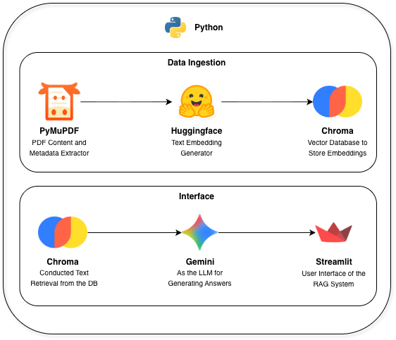

# ⚽️ AI-Assisted Football Referee 

## 📄 Summary
This is the GitHub repository for my AI Project on building an AI Assistant that answers questions regarding football law. The output is a Streamlit Dashboard, where users can asks any football-related questions, especially in case of a specific football rule. 

This project was inspired when I watched football games and there are several rules that I can't comprehend, like why the game keeps going while there's an obvious foul has happened or why a player got yellow card for celebrating a goal.

## Architecture

For implementing this project, Python is used as the foundation of it along with libraries such as:
- PyMuPDF for extracting document's text and metadata,
- Google AI to integrate LLM on our interface to make the answers easy to understand,
- Chroma as a vector database to store numerical representations of texts, which also called as Embeddings,
- Huggingface for generating the embeddings (We use the BGE Small model),
- Streamlit to generate a user-friendly interface to interact with the document and generate answers.

The exciting part is that I don't need to use any paid models!
The Gemini is free to use (limited amount of requests ofc) and the embedding is self hosted!

## Data Source
We used the IFAB's Law of The Game document as the baseline for our system. It comprises of Laws regarding of a football game. You can download the data through the IFAB website.
